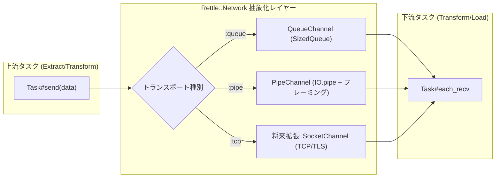

# 製品要件定義書 (PRD) - Rettle ネットワークサブシステム

[English](prd.md)

## 1. サブシステムの概要とビジョン

### 1.1. 概要
ネットワークサブシステム（`Rettle::Network`）は、Rettle ETLフレームワークにおける統合的かつトランスポート透過的な通信レイヤーを提供します。パイプラインの各ステージ（`extract`, `transform`, `load`）間のデータ交換を抽象化し、タスクが別スレッド、別プロセス、あるいはネットワーク境界を越えて稼働している場合でも、透過的にデータをストリーミングできるようにします。

### 1.2. アーキテクチャビジョン
Rettleの現段階の実装は軽量なインメモリ（スレッド）およびローカルプロセス間の並行実行を主な対象としていますが、`Rettle::Network` は意図的にローカル環境限定の設計とはしていません。

パイプラインの実行DSLと基盤となるデータ転送メカニズムを分離することにより、以下の拡張性を確保します：
- **ローカル並行実行（現行スコープ）**: 有界メモリキューやUnixパイプを使用し、低レイテンシかつ自動バックプレッシャー制御を備えたタスク間連携を実現。
- **分散パイプライン（将来のビジョン）**: パイプライン定義やタスク内の処理コードを変更することなく、トランスポートドライバー（TCPソケットやUNIXドメインソケットなど）を追加・指定可能とすることで、負荷の高いTransform処理やExtract処理を別サーバー、ワーカーノード、別コンテナ環境へシームレスにオフロード・分散実行できるようにします。

---

## 2. 対象ユーザーとスコープ

### 2.1. 対象ユーザー
* **Ruby / Rails 開発者**: タスクの契約（インターフェース）を変更することなく、並行実行モデル（スレッド vs プロセス）をスケールさせたいETLパイプラインの実装者。
* **システムアーキテクト**: データ量の増大に伴い、将来的なリモートノード分散や別ホスト実行への拡張パスを見据えたデータ取り込み基盤を設計する技術者。

### 2.2. 対象範囲（In Scope）
* **統一トランスポートインターフェース**: `Task#send` および `Task#each_recv` を支える標準API（`read`, `write`, `close`）。
* **スレッドベーストランスポート（`:queue`）**:
  * `Thread::SizedQueue` を用いたインメモリのスレッド間通信。
  * 後続ステージの処理遅延によるメモリ枯渇を防止する組み込みバックプレッシャー制御。
* **プロセスベーストランスポート（`:pipe`）**:
  * `IO.pipe` によるプロセス間通信（IPC）。
  * Ruby `Marshal` と16進数（HEX）文字列変換によるオブジェクトの直列化・非直列化。
  * 明示的なバイト長ヘッダーを用いたメッセージ境界フレーミングプロトコル。
* **パイプラインライフサイクルの統合**:
  * 前段タスク完了時（`Rettle#connect` のブロック終了時）におけるEOF／終了シグナルの自動伝播。
  * チャネルの安全なリソース解放（クローズ処理）。

### 2.3. 対象外（Out of Scope - 現フェーズ）
* 外部メッセージブローカーインフラ（Apache Kafka、RabbitMQ等）への依存。
* 複雑な分散クラスタ調整（Raft合意形成、リーダー選定等）。
* サービスディスカバリや動的メッシュルーティング。

---

## 3. 主要なソリューションと機能マップ

| 機能領域 | ソリューション機能 | 想定環境 | 優先度 |
| :--- | :--- | :--- | :--- |
| **インメモリスレッドストリーミング** | 容量制限付き（256件）`SizedQueue` チャネル | マルチスレッドローカルタスク | 高（実装済み） |
| **IPCプロセスストリーミング** | 長さプレフィックス付きMarshalペイロードによる `IO.pipe` チャネル | マルチプロセスローカルタスク | 高（実装済み） |
| **トランスポート透過性** | `Task` に委譲される統一 `read`/`write`/`close` インターフェース | すべての環境 | 高（実装済み） |
| **バックプレッシャー制御** | 下流タスクの過負荷時に上流の書き込みをブロックする有界バッファ | 大量データストリーミング | 高（実装済み） |
| **リモートノードストリーミング** | 分散タスク実行のための TCP/TLS ソケットトランスポート | マルチノード / クラウド分散 | 中（ロードマップ） |
| **バイナリフレーミング最適化** | 16進数文字列変換のオーバーヘッドを排除した純粋バイナリ通信 | パフォーマンス最適化 | 中（ロードマップ） |

---

## 4. アーキテクチャと技術設計

### 4.1. チャネル抽象化モデル
Rettle内のタスクは `Rettle::Task#send` および `Rettle::Task#each_recv` のみを通じて通信します。タスクは低レベルのI/O処理を、自身が保持する `Rettle::Network` インスタンスに委譲します。



### 4.2. サポートするトランスポート

#### 1. キュートランスポート (`type: :queue`)
* **基盤プリミティブ**: `Thread::SizedQueue.new(256)`
* **動作仕様**:
  * `write(data)`: キューへ直接プッシュ。キュー内に256件溜まっている場合、下流タスクが消費するまで呼び出し元スレッドをブロック（待機）。
  * `read`: キューからポップ。データが到着するかキューがクローズされるまで待機。
  * `close`: `SizedQueue#close` を実行。キューが空になると以降の `read` は `nil` を返し、タスク終了シグナルとして機能。

#### 2. パイプトランスポート (`type: :pipe`)
* **基盤プリミティブ**: `IO.pipe`（単方向匿名パイプ）
* **通信プロトコルとフレーミング**:
  * **シリアライズ**: `Marshal.dump(data).unpack("h*")[0]` により、任意のRubyオブジェクトを16進数文字列へエンコード。
  * **フレーミングヘッダー**: 改行（`\n`）で区切られたペイロード長（バイト数）。
  * **フレーム構造**:
    ```
    <ペイロードのバイト長>\n<16進数エンコードされたシリアライズデータ>
    ```
  * **読み取り手順**:
    1. `IO#readline` で1行読み取り、データ長を整数として取得。
    2. `IO#read(size)` で正確に指定サイズ分読み取り。
    3. `[payload].pack("h*")` および `Marshal.load` でオブジェクトを復元。
  * **EOF処理**: パイプの書き込み側がクローズされたことによる `EOFError` を捕捉し、`nil` を返却。

### 4.3. ライフサイクルと終了処理
1. **初期化**: 受信側タスク（`:transform`, `:load`）は初期化時に自身のネットワークチャネルを生成（`:extract` は受信チャネルを持たない）。
2. **タスク間接続**: `Rettle#connect` により、上流タスクブロックへ下流タスクの参照が渡される。
3. **正常終了通知**: 上流タスクの処理ブロック終了に伴い、`Rettle#connect` が接続先下流タスクのネットワーク `close` を順次実行。
4. **終了検知**: 下流の `each_recv` ループは、`read` が `nil` を返した時点で安全に終了。

---

## 5. 非機能要件

* **パフォーマンスとレイテンシ**:
  * インメモリのキュートランスポートは、ネイティブのスレッド同期と同等の極めて低いオーバーヘッドで動作すること。
  * パイプ／ストリーム通信において、適切なバッファフラッシュを行い、下流の読み取りデッドロックを防止すること。
* **メモリ安全性とバックプレッシャー**:
  * 大規模データバッチ処理時にメモリが無制限に増大するのを防ぐため、チャネルバッファ上限（`QUEUE_SIZE = 256`）を厳格に維持すること。
* **フォールトトレランスとリソース解放**:
  * 上流タスクで例外や中断が発生した場合でも、確実にファイルディスクリプタを閉じ、ブロック待機中のスレッドを解放すること。

---

## 6. 将来の拡張性と分散実行ロードマップ

1. **TCP / リモートソケットトランスポート (`:tcp`)**:
   * リモートサーバーや別コンテナ上のワーカープロセスを下流タスクとして接続可能にする。
   * エッジでの軽量Extractと、専用GPU/大容量メモリサーバーでの重いTransform処理といった異種ノード分散実行を実現。
2. **UNIXドメインソケット (`:unix`)**:
   * 親子プロセス関係の制約を受けずに、ローカルの独立したOSプロセス間で高速通信を行うためのIPC手段。
3. **バイナリ長プレフィックスフレーミングへの最適化**:
   * パイプ／ソケット通信における16進数文字列変換（`pack("h*")` / `unpack("h*")`）を、直接4バイトまたは8バイトのビッグエンディアンバイナリ長プレフィックスへ刷新し、I/O転送量とCPUシリアライズ負荷を半減させる。
