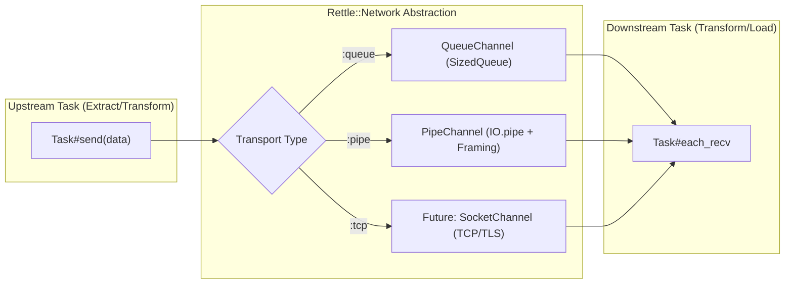

# Product Requirements Document (PRD) - Rettle Network Subsystem

[日本語 (Japanese)](prd.ja.md)

## 1. Subsystem Overview & Vision

### 1.1. Overview
The Network subsystem (`Rettle::Network`) provides a unified, transport-agnostic communication layer for the Rettle ETL framework. It abstracts data exchange between pipeline stages (`extract`, `transform`, `load`), enabling tasks to stream data seamlessly whether running in separate threads, separate processes, or across network boundaries.

### 1.2. Architectural Vision
While Rettle's immediate implementation targets lightweight in-memory and local inter-process concurrency, `Rettle::Network` is deliberately architected not to be restricted to the local environment.

By decoupling the pipeline execution DSL from the underlying data transport mechanism:
- **Local Concurrency (Current)**: Pipeline stages communicate with minimal latency and automatic backpressure using bounded memory queues or Unix pipes.
- **Distributed Pipelines (Future Vision)**: Without altering pipeline task definitions or user data-handling code, transport drivers (such as TCP sockets or Unix domain sockets) can be introduced to offload resource-intensive transformation or extraction stages to remote servers, worker nodes, or separate container instances.

---

## 2. Target Users & Scope

### 2.1. Target Users
* **Ruby & Rails Developers**: Building ETL workflows where pipeline steps need to scale independently across concurrency models (threads vs. processes) without changing task contracts.
* **Systems Architects**: Designing data ingestion pipelines with a path toward remote execution and distributed node processing as workload volume grows.

### 2.2. In Scope
* **Unified Transport Interface**: Standardized API (`read`, `write`, `close`) powering `Task#send` and `Task#each_recv`.
* **Thread-based Transport (`:queue`)**:
  * In-memory inter-thread communication backed by `Thread::SizedQueue`.
  * Built-in backpressure to prevent downstream pipeline stages from exhausting system memory.
* **Process-based Transport (`:pipe`)**:
  * Inter-Process Communication (IPC) via `IO.pipe`.
  * Object serialization and deserialization via Ruby `Marshal` with hex encoding.
  * Message framing protocol with explicit byte-length headers for robust stream parsing.
* **Pipeline Lifecycle Integration**:
  * Automatic EOF/termination propagation when upstream stages complete (`Rettle#connect` block exit).
  * Graceful channel teardown.

### 2.3. Out of Scope (Current Implementation)
* External message broker infrastructure (e.g., Apache Kafka, RabbitMQ).
* Complex distributed cluster coordination (e.g., Raft consensus, leader election).
* Automatic remote service discovery and network mesh routing.

---

## 3. Core Solutions & Feature Map

| Capability | Solution Feature | Target Environment | Priority |
| :--- | :--- | :--- | :--- |
| **In-Memory Thread Streaming** | `SizedQueue` channel with bounded capacity (256) | Multi-threaded local tasks | High (Implemented) |
| **IPC Process Streaming** | `IO.pipe` channel with length-prefixed Marshal payload | Multi-process local tasks | High (Implemented) |
| **Transport Transparency** | Unified `read`/`write`/`close` interface delegated to `Task` | All environments | High (Implemented) |
| **Backpressure Control** | Bounded channel buffers blocking upstream writes when downstream is saturated | High-volume streaming | High (Implemented) |
| **Remote Node Streaming** | TCP/TLS socket transport for distributed task execution | Multi-node / Hybrid cloud | Medium (Roadmap) |
| **Binary Serialization** | Raw binary framing without hex conversion overhead | Performance optimization | Medium (Roadmap) |

---

## 4. Architecture & Technical Design

### 4.1. Channel Abstraction Model
Tasks in Rettle interact solely with `Rettle::Task#send` and `Rettle::Task#each_recv`. The task delegates low-level I/O operations to an encapsulated `Rettle::Network` instance.



### 4.2. Supported Transports

#### 1. Queue Transport (`type: :queue`)
* **Underlying Primitive**: `Thread::SizedQueue.new(256)`.
* **Behavior**:
  * `write(data)`: Pushes directly into the queue. Suspends the calling thread if 256 items are queued until downstream consumes.
  * `read`: Pops from the queue. Suspends calling thread until an item arrives or queue is closed.
  * `close`: Calls `SizedQueue#close`. Downstream `read` returns `nil` when the queue is empty, signaling termination.

#### 2. Pipe Transport (`type: :pipe`)
* **Underlying Primitive**: `IO.pipe` (unidirectional anonymous pipe).
* **Wire Protocol & Framing**:
  * **Serialization**: `Marshal.dump(data).unpack("h*")[0]` converts arbitrary Ruby objects into a hexadecimal string.
  * **Framing Header**: Payload size in bytes followed by newline delimiter (`\n`).
  * **Frame Structure**:
    ```
    <payload_length_in_bytes>\n<hex_encoded_serialized_payload>
    ```
  * **Reading**:
    1. Read length line via `IO#readline` and parse integer size.
    2. Read exact payload bytes via `IO#read(size)`.
    3. Reconstruct object via `[payload].pack("h*")` and `Marshal.load`.
  * **EOF Handling**: Returns `nil` upon `EOFError` when the write end of the pipe is closed.

### 4.3. Lifecycle and Teardown
1. **Instantiation**: Receiver tasks (`:transform`, `:load`) instantiate their own network channel upon initialization (`type != :extract`).
2. **Channel Interconnection**: `Rettle#connect` passes receiver task references to upstream tasks.
3. **Graceful Completion**: Upon completion of the upstream processing block, `Rettle#connect` invokes `close` on all connected downstream task networks.
4. **Termination Signal**: Downstream `each_recv` loop terminates when `read` evaluates to `nil`.

---

## 5. Non-Functional Requirements

* **Performance & Latency**:
  * In-memory queue transport must incur negligible overhead over raw thread synchronization.
  * Pipe/stream transport must flush buffer headers reliably without deadlocking downstream readers.
* **Memory Safety & Backpressure**:
  * Channel buffers must remain bounded (`QUEUE_SIZE = 256`) to prevent unbound memory growth during large batch transformations.
* **Fault Tolerance & Cleanup**:
  * Channels must reliably close file descriptors and unblock awaiting threads when upstream tasks encounter fatal exceptions or shutdowns.

---

## 6. Future Extensibility & Distributed Roadmap

1. **TCP / Remote Socket Transport (`:tcp`)**:
   * Allow worker processes on remote hosts or separate containers to register as downstream tasks.
   * Enables heterogeneous workloads (e.g., lightweight extraction on edge, GPU/heavy transformation on dedicated cluster node).
2. **Unix Domain Sockets (`:unix`)**:
   * Faster IPC alternative to anonymous pipes for independent OS processes without parent-child inheritance constraints.
3. **Direct Binary Framing**:
   * Replace hex encoding (`pack("h*")` / `unpack("h*")`) in pipe/socket transports with direct binary 4-byte/8-byte big-endian length prefixing to halve I/O payload size and reduce CPU serialization overhead.

### Current channel contract

Only `:queue` and `:pipe` are supported; other types raise `ArgumentError`. `nil` is reserved for EOF and cannot be written. Pipe readers close their descriptor at EOF after buffered frames are consumed. Invalid or truncated frames raise `Rettle::Network::ProtocolError`; writes to a closed pipe reader raise `Rettle::Network::ClosedChannelError`.

On invalid pipe frames, the reader is closed and `ProtocolError` is raised. A receiving task closes its pipe reader when it terminates early; callers managing a channel directly can use `close_reader` to cancel reading. Writing to a closed channel raises `ClosedChannelError` for either transport.
