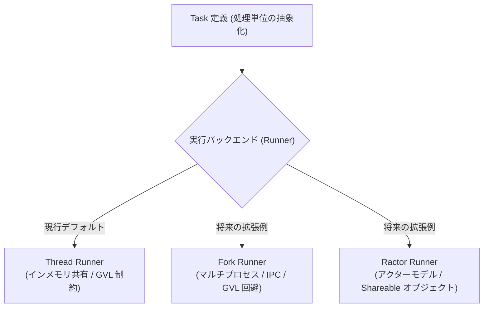

# 要求仕様書 (PRD) - Rettle Task サブシステム

[English](prd.md)

## 1. 概要と目的

### 1.1 概要
Rettle における `Rettle::Task` は、ETL パイプラインを構成する基盤的かつ抽象的な「処理単位（Processing Unit）」です。パイプラインは相互に接続されたタスクの非循環グラフとして構成され、データの抽出（Extract）、変換（Transform）、ロード（Load）へと継続的にストリーミング処理を行います。

### 1.2 目的と背景
Rettle はコードファーストのアプローチを採用しており、中核機能は先行して実装（`lib/rettle/task*.rb`）されています。本文書は以下の目的を持ちます：
* 既存の Task サブシステムの設計、振る舞い、インターフェースを明確な仕様として文書化・形式化する。
* `Task` を「処理単位の抽象化」として位置づけ、処理ロジックおよびタスク間データフローを、背後の並行処理メカニズムから疎結合に分離する。
* 現在のスレッドベース実行にとどまらず、将来的な並行処理バックエンド（プロセスベースの `fork` や Ruby 3 の `Ractor` など）への拡張に向けた設計方針と具体的な拡張例を提示する。

### 1.3 コアコンセプト: 処理単位としての Task 抽象化
`Task` は以下の要素をカプセル化します：
* **役割に応じた処理**: 各フェーズ（`extract`、`transform`、`load`）ごとに定義されたユーザーロジックの実行。
* **ストリーミング通信**: `each_recv` による入力データの継続的取得と、`send` による次段へのデータ送出。
* **ドメインヘルパー**: ETL 処理に特化した再利用可能なルーチン群（ダウンロード、解凍、文字コード変換、バッファリング付きエクスポートなど）。
* **実行境界**: 独立した実行コンテキストを持ち、背後の実行機構（現在は `Thread`）を変更してもユーザー向けのパイプライン定義に影響を与えない設計。

---

## 2. 現行アーキテクチャと仕様 (As-Is)

### 2.1 タスクの種別と構成
タスクは指定された `type` に基づき、Ruby のモジュールインクルードによって動的に構成されます：
* **`TaskCommon`**: すべてのタスク種別で共有されるユーティリティ（例: `encoding!`）。
* **`TaskExtract` (`:extract`)**:
  * パイプラインの起点。前段からのデータ受信は行いません（`@network` は未生成）。
  * 組み込みヘルパー: `download(url:, dir:, cleanup:)`、`git_clone(url:, dir:)`、自動 ZIP 展開（`after_download`）、オーバーライド可能な `downloader`。
* **`TaskTransform` (`:transform`)**:
  * 中間処理ノード。前段タスクから `each_recv` でデータを受け取り、変換後のデータを次段へ `send` で送出。
* **`TaskLoad` (`:load`)**:
  * パイプラインの終端ノード。データを受け取り、永続化先（DB、ファイル、外部ストレージなど）に出力。
  * 組み込みヘルパー: バッファリングを行う `export(data:, size:, flush:)`、カスタマイズ可能な `exporter(data)`。

### 2.2 データフローと通信層
タスク間の通信は `Rettle::Network` 抽象化によって仲介され、標準でバックプレッシャー機構を備えています：
* **`:queue` (デフォルト)**: バッファサイズを制限した Ruby の `SizedQueue`（`QUEUE_SIZE = 256`）を使用。キューが満杯になると送信側がブロックされ、メモリの無制限な肥大化を防止。
* **`:pipe`**: Unix の `IO.pipe` を使用し、直列化したオブジェクト（バイト長プレフィックス付きの 16進数エンコード `Marshal` ペイロード）を転送。
* **タスク接続**: `Rettle#connect(task_names)` によって確立。送信側タスクのブロック終了時に下流チャネルが一括クローズ（`close`）され、下流の受信側へ終了（`nil` / `EOFError`）を通知。

### 2.3 実行とウォッチドッグ機構
* **並行処理メカニズム**: 各タスクは `Task#run` により、独立した Ruby `Thread` 内で起動。
* **ライフサイクルの委譲**: `Task` はスレッド制御メソッド（`join`, `kill`）を内部の `@thread` に委譲。
* **ウォッチドッグによる監視**: IPC パイプ（`@watchdog_fd`）によりタスクの生存状態を監視。いずれかのタスクで未処理の例外が発生した場合、パイプにアラートフラグ（`"1"`）が書き込まれ、Rettle プロセス全体を直ちにフェイルファスト終了させてパイプラインの中途半端な状態を防止。

---

## 3. 並行処理の拡張性（将来の方向性）

### 3.1 処理ロジックと並行処理機構の分離
現在の `Rettle::Task` は Ruby `Thread` 上で実行されていますが、`Task` そのものは純粋な「処理単位」として抽象化されています。実行エンジン（Runner）をプラガブルなバックエンドとして分離することで、将来的に多様なワークロードに適応可能な構造を目指します。

### 3.2 並行処理モデルの例（方向性の提示）
以下は、将来検討されうる代表的な実行バックエンドの例です：

* **Thread Runner（現行ベースライン）**:
  * *特性*: 軽量、同一プロセス内のメモリ直接参照、最小限のオーバーヘッド。
  * *トレードオフ*: CPU バウンドなデータ変換時に Ruby の GVL（Global VM Lock）制約を受ける。I/O 待ち中心のタスクに最適。
* **Fork / マルチプロセス Runner（拡張例）**:
  * *特性*: `fork` を用いてタスクごとに独立した OS プロセスを生成。
  * *メリット*: GVL を完全に回避し、マルチコア CPU を活用して重いパースや計算処理を並列化可能。
  * *考慮点*: プロセス間通信（IPC）が必要（`Network` の `:pipe` モードと整合）。ファイルディスクリプタや DB コネクションの再初期化が必要。
* **Ractor Runner（拡張例）**:
  * *特性*: Ruby 3 のネイティブアクターモデル（`Ractor`）を活用。
  * *メリット*: 単一 OS プロセス内でプロセスのフォーク負荷を伴わずにマルチコア並列実行を実現。
  * *考慮点*: オブジェクト共有に関する厳格な制約（Shareable / Frozen オブジェクト）や Ractor ポートを介したメッセージ送受信への適合。

### 3.3 拡張の原則
* **DSL の安定性**: バックエンドが変更されても、ユーザー側のタスク記述 API（`define_task`, `connect`, `task.each_recv`, `task.send`）は統一されたインターフェースを維持すること。
* **関心の分離**: Task のドメインロジック（ETL の処理内容やヘルパー）に、特定の並行処理プリミティブに依存した前提を持ち込まないこと。

---

## 4. 機能要件

### 4.1 タスク定義と構成
* **FR-1**: 明示的な種別（`:extract`, `:transform`, `:load`）およびユニークなタスク名によるタスク定義をサポートすること。
* **FR-2**: タスク種別に応じて、適切なモジュールヘルパー（`TaskCommon`, `TaskExtract`, `TaskTransform`, `TaskLoad`）をインクルードすること。
* **FR-3**: `task.proc` によるカスタム実行ブロックの設定をサポートすること。

### 4.2 ストリーム処理とチャネル管理
* **FR-4**: `Task#each_recv` は、ストリーム終端（`nil`）を検出するまで受信データを継続してブロックへ渡すこと。
* **FR-5**: `Task#send` は、接続先タスクのネットワークチャネルへデータを送信すること。
* **FR-6**: `Rettle#connect` は指定されたタスク群をブロックへ引き渡し、ブロック終了時にすべての接続チャネルを確実にクローズすること。

### 4.3 タスクヘルパー
* **FR-7 (Extract)**: URL からのファイルダウンロード、ディレクトリ作成・クリーンアップ、ZIP アーカイブの自動解凍をサポートすること。
* **FR-8 (Extract)**: Git リポジトリのクローンおよびプル同期をサポートすること。
* **FR-9 (Common)**: 一時ファイルを用いた UTF-8 への文字コード変換（`encoding!`）をサポートすること。
* **FR-10 (Load)**: インメモリバッファ（`export`）を提供し、バッファサイズ到達時または明示的なフラッシュ要求時にバッチ出力処理（`exporter`）を呼び出すこと。

### 4.4 監視とライフサイクル
* **FR-11**: タスクの並行起動（`run`）、同期待ち（`join`）、終了（`kill`）をサポートすること。
* **FR-12**: いずれかのタスク内で未処理の例外が発生した場合、直ちにウォッチドッグへ通知してプロセス全体を安全に終了させること。

---

## 5. 非機能要件

### 5.1 パフォーマンスとメモリフットプリント
* **バックプレッシャー**: 通信チャネルに上限（`SizedQueue` や OS パイプバッファ）を設けることで、大量データストリーミング時におけるメモリの過剰消費を抑止すること。
* **低オーバーヘッド通信**: メモリ共有環境においては、不要な直列化オーバーヘッドを最小化すること。

### 5.2 信頼性と耐障害性
* **フェイルファスト終了**: 一部タスクの異常終了によりパイプラインが無応答・ハング状態のまま残ることを防ぎ、ウォッチドッグ機構によって直ちに安全に全体を停止させること。
* **冪等なリソースクリーンアップ**: 通信チャネルやダウンロード作業ディレクトリなどの中間リソースを安全に解放できること。

### 5.3 保守性と互換性
* **Ruby 互換性**: 現代的な Ruby バージョン（Ruby 3.0+）で安定して動作すること。
* **モジュール拡張性**: ヘルパーや将来の並行処理ランナーがモジュール化され、独立したテストや段階的な拡張が可能であること。

## 接続と障害時の動作の補足

`connect`が返す宛先タスクの`send`は、そのタスクの入力チャネルへデータを書き込みます。extractタスクには入力チャネルがありません。接続ブロックが例外で終了した場合も宛先のチャネルを閉じます。処理ブロックのないタスクは何も実行しません。タスクが失敗した場合、他のタスクを停止し、元の例外を`run`の呼び出し元に伝えます。`encoding!`は指定された文字コードに変換し、省略時はUTF-8を使います。

## 補足: タスクヘルパーの動作

文字コード変換は変換元の文字コードを指定でき、省略時はRubyの外部エンコーディングを使う。ダウンロードにはディレクトリが必要で、ZIPの無圧縮ファイルとコロンを含むファイル名にも対応する。Gitリポジトリ名のドットを保持する。exportはfalseをデータとして扱い、nilはデータなしを表す。タスク内の例外は監視側に通知する。
