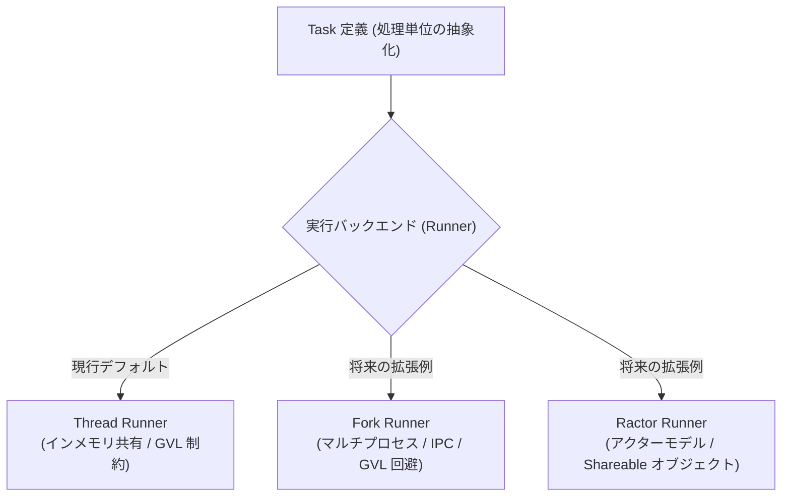

# 要求仕様書 (PRD) - Rettle Task サブシステム

[English](prd.md)

## 1. 概要と目的

### 1.1 概要
Rettle における `Rettle::Task` は、ETL パイプラインを構成する基盤的かつ抽象的な「処理単位（Processing Unit）」です。パイプラインは相互に接続されたタスクの非循環グラフとして構成され、データの抽出（Extract）、変換（Transform）、ロード（Load）へと継続的にストリーミング処理を行います。

### 1.2 目的と背景
Rettle はコードファーストのアプローチを採用しており、中核機能は先行して実装（`lib/rettle/task*.rb`）されています。本文書は以下の目的を持ちます：
* 既存の Task サブシステムの設計、振る舞い、インターフェースを明確な仕様として文書化・形式化する。
* `Task` を「処理単位の抽象化」として位置づけ、処理ロジックおよびタスク間データフローを、背後の並行処理メカニズムから疎結合に分離する。
* マルチスレッド環境（Solid Queue や ActiveJob 等の並列ワーカー基盤）における信頼性とスレッドセーフティの要件を定義する。
* 現在のスレッドベース実行にとどまらず、将来的な並行処理バックエンド（プロセスベースの `fork` や Ruby 3 の `Ractor` など）への拡張に向けた設計方針と具体的な拡張例を提示する。

### 1.3 コアコンセプト: 処理単位としての Task 抽象化
`Task` は以下の要素をカプセル化します：
* **役割に応じた処理**: 各フェーズ（`extract`、`transform`、`load`）ごとに定義されたユーザーロジックの実行。
* **ストリーミング通信**: `each_recv` による入力データの継続的取得と、`send` による次段へのデータ送出。
* **ドメインヘルパー**: ETL 処理に特化した再利用可能なルーチン群（ストリーミングダウンロード、解凍、文字コード変換、バッファリング付きエクスポートなど）。
* **実行境界**: 独立した実行コンテキストを持ち、背後の実行機構（現在は `Thread`）を変更してもユーザー向けのパイプライン定義に影響を与えない設計。
* **Share-nothing 境界**: 定義時に明示的な初期パラメータを受け取り、結果はメッセージパッシングチャネルを通じて親へ送出（`emit`）する。外部スコープのクロージャ捕捉や共有変数の更新を排除し、プロセス分離（`fork`）やマルチスレッド環境下での安全性を担保する設計。

---

## 2. アーキテクチャと仕様 (As-Is & To-Be)

### 2.1 タスクの種別と構成
タスクはクラス全体のモンキーパッチを避け、タスクインスタンスごとに `extend` を用いて種別に応じたヘルパーモジュールを動的に組み込みます：
* **`TaskCommon`**: すべてのタスク種別で共有されるユーティリティ（例: `encoding!`）。
* **`TaskExtract` (`:extract`)**:
  * パイプラインの起点。前段からのデータ受信チャネルは持ちません（`@network` は未生成）。
  * 組み込みヘルパー: `download(url:, dir:, cleanup:)`、`git_clone(url:, dir:)`、自動アーカイブ展開（`after_download`）、オーバーライド可能な `downloader`。
  * **スレッドセーフティとパス指定**: プロセス全体で共有されるカレントディレクトリ（`Dir.chdir`）の変更を全廃し、明示的なパス指定（`File.join(dir, ...)`, `git -C <dir>` 等）のみで安全に動作する。
* **`TaskTransform` (`:transform`)**:
  * 中間処理ノード。前段タスクから `each_recv` でデータを受け取り、変換後のデータを次段へ `send` で送出。
* **`TaskLoad` (`:load`)**:
  * パイプラインの終端ノード。データを受け取り、永続化先（DB、ファイル、外部ストレージなど）に出力。
  * 組み込みヘルパー: バッファリングを行う `export(data:, size:, flush:)`、カスタマイズ可能な `exporter(data)`。

### 2.2 データフローと通信層
タスク間の通信は `Rettle::Network` 抽象化によって仲介され、標準でバックプレッシャー機構を備えています：
* **`:queue` (デフォルト)**: バッファサイズを制限した Ruby の `SizedQueue`（デフォルト `QUEUE_SIZE = 256`、設定可能）を使用。キューが満杯になると送信側がブロックされ、メモリの無制限な肥大化を防止。
* **`:pipe`**: Unix の `IO.pipe` を使用し、直列化したオブジェクト（バイト長プレフィックス付きの 16進数エンコード `Marshal` ペイロード）を転送。
* **タスク接続**: `Rettle#connect(task_names)` によって確立。送信側タスクのブロック終了時に下流チャネルが一括クローズ（`close`）され、下流の受信側へ終了（`nil` / `EOFError`）を通知。ブロック内で例外が発生した場合も宛先チャネルは確実にクローズされる。

### 2.3 実行、監視とエラー伝播
* **並行処理メカニズム**: 各タスクは `Task#run` により、独立した Ruby `Thread` 内で起動。
* **ライフサイクルの委譲**: `Task` はスレッド制御メソッド（`join`, `kill`）を内部の `@thread` に委譲。
* **ウォッチドッグによる監視と例外伝播**: IPC パイプ（`@watchdog_fd`）によりタスクの生存状態を監視。いずれかのタスクで未処理の例外が発生した場合：
  1. タスクはウォッチドッグパイプにフラグ（`"1"`）を書き込み、例外を保持する。
  2. スーパーバイザは他タスクを安全に停止（終了待機・終了処理）する。
  3. 最初の例外を `Rettle#run` / `run!` の呼び出し元へ再送出（re-raise）する。
  4. ライブラリ内部で `Kernel.exit` は呼び出さず、呼び出し元のジョブ基盤（ActiveJob や Rake）へ例外伝播とリトライ制御を委ねる。

### 2.4 パラメータ注入と結果収集 (`emit` / `results`)
プロセス分離（`fork`）下での完全な動作保証および共有クロージャによる競合状態を排除するため：
* **明示的な初期パラメータ注入**: `define_task(name, params: { ... })` によりタスク実行に必要なパラメータを明示的に渡し、タスクブロック内から参照可能とする。外部変数の暗黙的な捕捉を不要とする。
* **出力結果の送出 (`task.emit`)**: タスクが実行完了ステータスやサマリー結果を親パイプラインへ返却するための `task.emit(payload)` を提供する。これは `Rettle::Network` プリミティブ（スレッド時はキュー、プロセス時は IPC パイプ）に基づく親専用の通信チャネルを介して行われる。
* **結果の集約 (`etl.results`)**: パイプライン実行完了時に、親スーパーバイザが全タスクから `emit` されたデータを収集し、`etl.results` として集約・提供する。スレッド共有変数を用いずにタスク実行結果を安全に検証・取得可能とする。

---

## 3. 並行処理の拡張性（将来の方向性）

### 3.1 処理ロジックと並行処理機構の分離
現在の `Rettle::Task` は Ruby `Thread` 上で実行されていますが、`Task` そのものは純粋な「処理単位」として抽象化されています。実行エンジン（Runner）をプラガブルなバックエンドとして分離することで、将来的に多様なワークロードに適応可能な構造を目指します。

### 3.2 並行処理モデルの例（方向性の提示）
以下は、将来検討されうる代表的な実行バックエンドの例です：

* **Thread Runner（現行ベースライン）**:
  * *特性*: 軽量、同一プロセス内のメモリ直接参照、最小限のオーバーヘッド。
  * *トレードオフ*: CPU バウンドなデータ変換時に Ruby の GVL（Global VM Lock）制約を受ける。I/O 待ち中心のタスクに最適。
* **Fork / マルチプロセス Runner（拡張例）**:
  * *特性*: `fork` を用いてタスクごとに独立した OS プロセスを生成。
  * *メリット*: GVL を完全に回避し、マルチコア CPU を活用して重いパースや計算処理を並列化可能。
  * *考慮点*: プロセス間通信（IPC）が必要（`Network` の `:pipe` モードと整合）。ファイルディスクリプタや DB コネクションの再初期化が必要。
* **Ractor Runner（拡張例）**:
  * *特性*: Ruby 3 のネイティブアクターモデル（`Ractor`）を活用。
  * *メリット*: 単一 OS プロセス内でプロセスのフォーク負荷を伴わずにマルチコア並列実行を実現。
  * *考慮点*: オブジェクト共有に関する厳格な制約（Shareable / Frozen オブジェクト）や Ractor ポートを介したメッセージ送受信への適合。

### 3.3 拡張の原則
* **DSL の安定性**: バックエンドが変更されても、ユーザー側のタスク記述 API（`define_task`, `connect`, `task.each_recv`, `task.send`）は統一されたインターフェースを維持すること。
* **関心の分離**: Task のドメインロジック（ETL の処理内容やヘルパー）に、特定の並行処理プリミティブに依存した前提を持ち込まないこと。

---

## 4. 機能要件

### 4.1 タスク定義と構成
* **FR-1**: 明示的な種別（`:extract`, `:transform`, `:load`）およびユニークなタスク名によるタスク定義をサポートすること。
* **FR-2**: タスク種別に応じて、適切なモジュールヘルパー（`TaskCommon`, `TaskExtract`, `TaskTransform`, `TaskLoad`）をインスタンス単位で `extend` により組み込むこと。
* **FR-3**: `task.proc` によるカスタム実行ブロックの設定をサポートすること。ブロックのないタスクは何も実行しないこと。

### 4.2 ストリーム処理とチャネル管理
* **FR-4**: `Task#each_recv` は、ストリーム終端（`nil`）を検出するまで受信データを継続してブロックへ渡すこと。
* **FR-5**: `Task#send` は、接続先タスクの入力チャネルへデータを書き込むこと。extract タスクは入力チャネルを持たないこと。
* **FR-6**: `Rettle#connect` は指定されたタスク群をブロックへ引き渡し、ブロック終了時（例外発生時を含む）にすべての接続チャネルを確実にクローズすること。

### 4.3 タスクヘルパー
* **FR-7 (Extract - ダウンローダーの堅牢化とストリーミング)**:
  * URL からのファイルダウンロード、対象ディレクトリの自動準備、オプション指定による自動クリーンアップをサポートすること（ディレクトリ指定必須）。
  * 大容量ファイルダウンロード時もメモリを圧迫しないよう、ディスクへの直接ストリーミング書き込み（`Net::HTTP` チャンク読み込み）を行うこと。
  * HTTP リダイレクト（301/302）の追従（回数上限設定付き）をサポートすること。
  * 接続/読み取りタイムアウト設定および一時的な通信エラーに対する簡易リトライをサポートすること。
  * メタデータ（`etag`, `last_modified`, `content_length`, `sha256`）の取得、および条件付きリクエスト（`If-None-Match`, `If-Modified-Since` による 304 判定で不要な再ダウンロードと後続処理のスキップ）をサポートすること。
* **FR-8 (Extract - Git リポジトリ同期)**:
  * `git -C <dir>` を用いてプロセスグローバルなカレントディレクトリを変更せずに Git クローンおよびプル同期をサポートすること（リポジトリ名のドットを保持）。
* **FR-9 (Extract - アーカイブ自動展開)**:
  * ダウンロードしたアーカイブ（ZIP、`.tar.gz`、`.gz` 等）を `Dir.chdir` を行わずに展開先ディレクトリへ安全に解凍すること。ZIP の無圧縮エントリやコロンを含むファイル名にも正常に対応すること。
* **FR-10 (Common - ファイル文字コード変換)**:
  * 一時ファイルのスワップにより、指定された文字コード（省略時は UTF-8）への変換（`encoding!`）をサポートすること。変換元の文字コードを指定可能とし、省略時は Ruby の外部エンコーディングを使用すること。
* **FR-11 (Load - バッファリング付きエクスポート)**:
  * インメモリバッファ（`export`）を提供し、バッファサイズ到達時または明示的なフラッシュ要求時にバッチ出力処理（`exporter`）を呼び出すこと。`false` は有効なデータとして扱い、`nil` はデータなしを表すこと。

### 4.4 監視とライフサイクル
* **FR-12**: タスクの並行起動（`run`）、同期待ち（`join`）、終了（`kill`）をサポートすること。
* **FR-13 (エラーハンドリングと例外伝播)**: いずれかのタスク内で未処理の例外が発生した場合、直ちにウォッチドッグへ通知し、他タスクを停止した上で元の例外を `run` / `run!` の呼び出し元へ再送出すること。ライブラリ内部で `Kernel.exit` を呼び出さないこと。
* **FR-14 (Phase 2 Preview - 観測性とライフサイクルフック)**: パイプラインおよびタスクのイベント（`on_start`, `on_finish`, `on_error`）にフックするコールバック機構と、タスクごとの処理件数カウントを提供すること。
* **FR-15 (Phase 2 Preview - 柔軟な設定と標準例外体系)**: 外部ロガー（`Rails.logger` 等）の注入、キューバッファサイズ（`queue_size`）の調整を可能とし、`Rettle::Error` 以下の標準化された例外（`Rettle::UndefinedError` 等）を提供すること。

### 4.5 パラメータ注入と結果収集
* **FR-16 (明示的な初期パラメータ注入)**: `define_task` においてタスク実行に必要なパラメータ（`params: ...`）を受け取り、タスクブロック内からアクセス可能とすること。ミュータブルな外部スコープのクロージャ捕捉への依存を排除すること。
* **FR-17 (結果の送出と集約)**: 各タスクが `task.emit(payload)` を呼び出して親パイプラインへ直列化可能な結果データを送信できること。パイプラインスーパーバイザは送出されたデータを収集し、実行完了時に `etl.results` として参照可能とすること。
* **FR-18 (厳格な Share-nothing 通信)**: タスク間および呼び出し元との間で、インメモリ共有変数を介した通信を行わないこと。すべてのデータ交換はストリーミングチャネル（`Network`）または結果送出（`emit`）を経由して行うこと。

---

## 5. 非機能要件

### 5.1 パフォーマンスとメモリフットプリント
* **バックプレッシャー**: 通信チャネルに上限（`SizedQueue` や OS パイプバッファ）を設けることで、大量データストリーミング時におけるメモリの過剰消費を抑止すること。
* **ストリーミング I/O**: 大容量ファイルのダウンロードやエクスポートはストリーミングで行い、ペイロードサイズに依存しない最小限のメモリフットプリントを維持すること。
* **低オーバーヘッド通信**: メモリ共有環境においては、不要な直列化オーバーヘッドを最小化すること。

### 5.2 信頼性と耐障害性
* **プロセスグローバル状態の非汚染（スレッドセーフティ）**: タスクヘルパー内で `Dir.chdir` などのプロセスグローバルな状態変更を決して行わないこと。Solid Queue などのマルチスレッドワーカー環境において安全に並行実行できること。
* **プロセス分離への適応性と Share-nothing 設計**: タスク間または親パイプラインとの間で暗黙的なメモリや可変状態の共有を行わず、スレッド、プロセス（`fork`）、アクターモデルいずれのバックエンドでも同一の挙動を保証すること。
* **ライブラリ規律**: CLI ツールではなく組み込みライブラリとして動作し、例外を握り潰したり `exit` でプロセスを強制終了したりせず、上位フレームワークへ例外を伝播すること。
* **フェイルファスト終了**: 一部タスクの異常終了によりパイプラインが無応答・ハング状態のまま残ることを防ぎ、ウォッチドッグ機構によって直ちに他タスクを停止して元の例外を伝播すること。
* **冪等なリソースクリーンアップ**: 通信チャネルやダウンロード作業ディレクトリなどの中間リソースを安全に解放できること。

### 5.3 保守性と互換性
* **Ruby 互換性**: 現代的な Ruby バージョン（Ruby 3.0+）で安定して動作すること。
* **モジュール拡張性**: ヘルパーや将来の並行処理ランナーがモジュール化され、独立したテストや段階的な拡張が可能であること。
