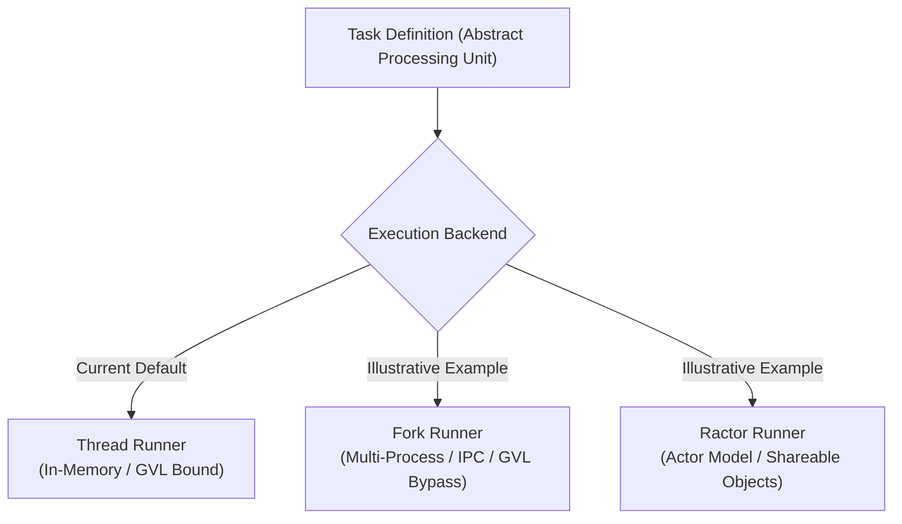

# Product Requirements Document (PRD) - Rettle Task Subsystem

[日本語 (Japanese)](prd.ja.md)

## 1. Overview & Objectives

### 1.1 Overview
In Rettle, `Rettle::Task` represents the foundational, abstract processing unit of the ETL pipeline. A pipeline is structured as an acyclic graph of interconnected tasks that continuously stream data from extraction, through transformation, to final loading.

### 1.2 Purpose & Context
Rettle follows a code-first development approach where core functionality was initially established in code (`lib/rettle/task*.rb`). This document serves to:
* Formalize and document the design, behavior, and interfaces of the existing Task subsystem.
* Define `Task` as an abstract unit of execution, decoupling the processing definition and inter-task data flow from the underlying concurrency mechanism.
* Establish reliability and thread-safety requirements for concurrent environments (e.g., multi-threaded background workers such as Solid Queue / ActiveJob).
* Establish design principles and illustrative directions for future concurrency backends beyond the current thread-based execution (e.g., process-based `fork` or Ruby 3 `Ractor`).

### 1.3 Core Concept: Task as an Abstract Processing Unit
A `Task` encapsulates:
* **Role-Specific Processing**: Executing user-provided logic defined for a specific phase (`extract`, `transform`, or `load`).
* **Streaming Communication**: Pulling incoming items via `each_recv` and sending items to destination tasks via `send`.
* **Domain Helpers**: Reusable routines tailored to ETL operations (e.g., streaming download, decompression, character encoding conversion, buffered export).
* **Execution Boundary**: An independent execution context whose execution mechanics (currently `Thread`) can be varied without changing user-facing pipeline definitions.
* **Share-Nothing Boundary**: Receives explicit input parameters at definition and emits collected outputs via message-passing channels without mutating or capturing external shared closures, ensuring readiness for process-isolated and multi-threaded execution alike.

---

## 2. Current Architecture & Specifications (As-Is & To-Be)

### 2.1 Task Types & Composition
Tasks are dynamically composed per instance using Ruby module extension (`extend`) based on their `type`, avoiding class-level monkey patching:
* **`TaskCommon`**: Shared utility methods available to all task types (e.g., `encoding!`).
* **`TaskExtract` (`:extract`)**:
  * Origin of the pipeline. Does not receive incoming data (`@network` is omitted).
  * Built-in helpers: `download(url:, dir:, cleanup:)`, `git_clone(url:, dir:)`, automatic archive expansion (`after_download`), and overridable `downloader`.
  * **Thread-Safety & Path Hygiene**: All helper operations avoid altering the process-global working directory (`Dir.chdir`), operating purely via explicit paths (e.g., `File.join(dir, ...)`, `git -C <dir>`).
* **`TaskTransform` (`:transform`)**:
  * Intermediate processing node. Receives data from upstream tasks via `each_recv` and sends transformed data to destination tasks obtained from `connect`.
* **`TaskLoad` (`:load`)**:
  * Terminal node of the pipeline. Ingests data and persists it into targets (databases, files, remote storage).
  * Built-in helpers: `export(data:, size:, flush:)` for buffered batching and customizable `exporter(data)`.

### 2.2 Data Flow & Communication Layer
Task-to-task communication is mediated by the `Rettle::Network` abstraction, providing built-in backpressure:
* **`:queue` (Default)**: Uses Ruby's `SizedQueue` with a bounded buffer (`QUEUE_SIZE = 256` by default, configurable). Pushing to a full queue blocks the sender, naturally preventing unbounded memory growth.
* **`:pipe`**: Uses Unix `IO.pipe` transmitting serialized objects (length-prefixed hex-encoded `Marshal` payload).
* **Task Connection**: Established via `Rettle#connect(task_names)`. Once the sender completes its execution block, downstream channels are closed (`close`), signaling termination (`nil` / `EOFError`) to downstream consumers.

### 2.3 Execution, Supervision & Error Propagation
* **Concurrency Mechanism**: Each task is initiated within an independent Ruby `Thread` via `Task#run`.
* **Lifecycle Delegation**: `Task` delegates thread management methods (`join`, `kill`) to its internal `@thread`.
* **Watchdog Supervision & Fail-Fast Propagation**: An IPC watchdog pipe (`@watchdog_fd`) monitors task health. If any task encounters an unhandled exception:
  1. The task alerts the supervisor via the watchdog pipe and holds the exception.
  2. The supervisor halts the other tasks in the pipeline cleanly.
  3. The supervisor re-raises the original exception to the caller (`Rettle#run` / `run!`).
  4. The library never calls `exit`, allowing enclosing job runners (ActiveJob, Rake, test suites) to retry, log, or alert normally.

### 2.4 Task Parameters & Result Collection (`emit` / `results`)
To guarantee execution integrity across process boundaries (`fork`) and eliminate race conditions from shared closures:
* **Explicit Parameter Injection**: Tasks accept initial parameters explicitly via `define_task(name, params: { ... })`, accessible within the task execution block, eliminating dependency on captured external variables.
* **Output Emission (`task.emit`)**: Tasks can communicate completion status or summary outputs back to the pipeline supervisor using `task.emit(payload)`. This utilizes a dedicated parent-facing communication channel backed by `Rettle::Network` primitives (thread queue or IPC pipe).
* **Result Aggregation (`etl.results`)**: Upon pipeline completion, the parent supervisor collects all emitted items from tasks into `etl.results`, making task execution outcomes inspectable without thread-shared mutable variables.

---

## 3. Concurrency & Execution Extensibility (Future Directions)

### 3.1 Decoupling Concurrency from Processing Logic
While `Rettle::Task` currently executes on Ruby `Thread`s, `Task` itself is designed as an abstract unit of work. The specific concurrency engine should eventually be treatable as a pluggable backend or execution strategy, allowing Rettle to adapt to diverse workloads.

### 3.2 Illustrative Concurrency Models
The following execution strategies represent potential architectural directions:

* **Thread Runner (Current Baseline)**:
  * *Characteristics*: Lightweight, shared in-memory object reference, minimal overhead.
  * *Trade-offs*: Constrained by Ruby's Global VM Lock (GVL) during CPU-intensive data transformations. Ideal for I/O-bound tasks.
* **Fork / Multi-Process Runner (Illustrative Example)**:
  * *Characteristics*: Spawns isolated OS processes for tasks using `fork`.
  * *Opportunities*: Completely bypasses the GVL, utilizing multi-core CPUs for heavy parsing and transformation.
  * *Considerations*: Requires IPC data transfer (aligning naturally with `Network`'s `:pipe` mode) and explicit handling of file descriptors and database connections across process boundaries.
* **Ractor Runner (Illustrative Example)**:
  * *Characteristics*: Employs Ruby 3's native actor-model concurrency (`Ractor`).
  * *Opportunities*: Multi-core parallel execution within a single OS process without process-forking overhead.
  * *Considerations*: Adheres to strict object sharing rules (deeply frozen or moved objects) and Ractor communication ports.

### 3.3 Extensibility Principles
* **DSL Stability**: The user-facing API (`define_task`, `connect`, `task.each_recv`, `task.send`) must remain consistent regardless of the underlying concurrency runner.
* **Separation of Concerns**: Task domain logic (ETL operations and helpers) must not leak assumptions about specific concurrency primitives.

---

## 4. Functional Requirements

### 4.1 Task Definition & Configuration
* **FR-1**: Must allow defining tasks with explicit types (`:extract`, `:transform`, `:load`) and unique task names.
* **FR-2**: Must inject appropriate module helpers (`TaskCommon`, `TaskExtract`, `TaskTransform`, `TaskLoad`) per task instance via `extend` based on the task type.
* **FR-3**: Must support custom execution blocks via `task.proc`.

### 4.2 Stream Processing & Channel Management
* **FR-4**: `Task#each_recv` must iterate over incoming data items until an end-of-stream indicator (`nil`) is encountered.
* **FR-5**: `Task#send` writes an item to that destination task’s inbound channel; extract tasks have no inbound channel.
* **FR-6**: `Rettle#connect` must yield designated target tasks and close destination channels even if the block raises.

### 4.3 Task Helpers
* **FR-7 (Extract - Downloader Robustness & Streaming)**:
  * Must support URL downloading with optional automatic cleanup and target directory preparation.
  * Must write response bodies via direct disk streaming (`Net::HTTP` chunked streaming) to avoid loading large payloads into memory.
  * Must support following HTTP redirects (301/302) with a configurable maximum redirect limit.
  * Must support network timeouts (open/read) and transient error retries.
  * Must support retrieving download metadata (`etag`, `last_modified`, `content_length`, `sha256`) and conditional HTTP requests (`If-None-Match`, `If-Modified-Since`) to detect unchanged resources (HTTP 304) and skip redundant downloads/tasks.
* **FR-8 (Extract - Git Repository Sync)**:
  * Must support Git repository cloning and pull synchronization using directory-targeted commands (`git -C <dir>`), preserving dots in repository names without altering `Dir.pwd`.
* **FR-9 (Extract - Archive Decompression)**:
  * Must automatically decompress downloaded archives (ZIP, `.tar.gz`, `.gz`) into the target directory, handling stored entries and colons in filenames without mutating `Dir.pwd`.
* **FR-10 (Common - File Encoding)**:
  * Must support file encoding conversion to the requested encoding (UTF-8 by default) via temporary file swapping; callers can specify the source encoding (default: Ruby external encoding).
* **FR-11 (Load - Buffered Export)**:
  * Must provide an in-memory buffer (`export`) that automatically triggers batch flushing (`exporter`) when the buffer threshold is reached or when explicitly flushed; `false` is a valid item and `nil` means no item.

### 4.4 Supervision & Lifecycle
* **FR-12**: Must support concurrent task startup (`run`), synchronous waiting (`join`), and termination (`kill`).
* **FR-13 (Error Handling & Propagation)**: Must alert the supervisor watchdog immediately upon unhandled exceptions within any task execution thread, cleanly terminate peer tasks, and re-raise the initial exception to the caller without invoking `Kernel.exit`.
* **FR-14 (Phase 2 Preview - Observability & Lifecycle Hooks)**: Must provide hooks for pipeline and task events (`on_start`, `on_finish`, `on_error`) and support item processed counters.
* **FR-15 (Phase 2 Preview - Configuration & Error Hierarchy)**: Must allow configuring logger instances (e.g., `Rails.logger`), queue buffer size (`queue_size`), and provide standardized exceptions under `Rettle::Error` (e.g., `Rettle::UndefinedError`).

### 4.5 Task Parameters & Result Collection
* **FR-16 (Explicit Parameter Injection)**: `define_task` must accept initial parameters (`params: ...`) and make them accessible inside the task block, removing the need to capture mutable external closures.
* **FR-17 (Result Emission & Aggregation)**: `Task#emit` must allow tasks to transmit arbitrary serializable result data to the parent pipeline. The pipeline supervisor must collect emitted payloads and expose them via `etl.results` upon completion.
* **FR-18 (Strict Share-Nothing Communication)**: Tasks must not communicate across task boundaries or with the caller via shared in-memory variables. All data exchange must proceed via streaming channels (`Network`) or result emission (`emit`).

---

## 5. Non-Functional Requirements

### 5.1 Performance & Memory Footprint
* **Backpressure**: Memory consumption must remain bounded during high-volume streaming by leveraging bounded communication channels (`SizedQueue` or OS pipes).
* **Streaming I/O**: Large file downloads and exports must operate in streaming mode to keep task memory footprint minimal and independent of payload size.
* **Low Latency Hand-off**: Data passing between tasks must minimize serialization overhead when running in shared-memory environments.

### 5.2 Reliability & Fault Tolerance
* **Process-Global State Hygiene (Thread-Safety)**: Task helpers must never call `Dir.chdir` or mutate global process state. All path operations must be explicit and safe for concurrent execution in multi-threaded environments (e.g., Solid Queue workers).
* **Process-Isolation Readiness & Share-Nothing Architecture**: Memory and mutable state must not be shared implicitly across tasks or with the parent pipeline, guaranteeing that pipeline behavior remains identical under thread, process-fork, and actor-based execution.
* **Library Discipline**: Rettle must behave strictly as an embeddable library. Failures must propagate as standard Ruby exceptions rather than halting the Ruby VM via `exit`.
* **Fail-Fast Termination**: The failure of an individual task must not leave the pipeline in a hung or zombie state; the watchdog mechanism must guarantee termination of peer task threads and propagation of the task exception to the caller.
* **Idempotent Resource Cleanup**: Network channels and intermediate files (such as download working directories) must support safe, idempotent cleanup.

### 5.3 Maintainability & Compatibility
* **Ruby Compatibility**: Compatible with modern Ruby versions (Ruby 3.0+).
* **Modular Extensibility**: Helpers and future concurrency runners must be modularly structured to allow isolated testing and independent evolution.
