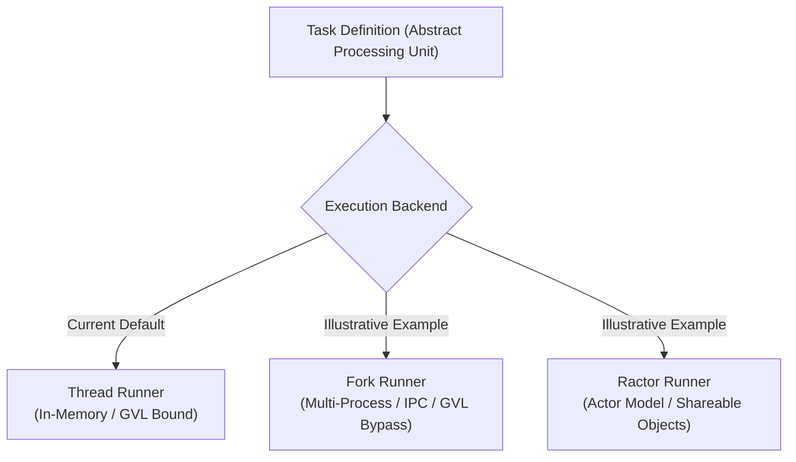

# Product Requirements Document (PRD) - Rettle Task Subsystem

[日本語 (Japanese)](prd.ja.md)

## 1. Overview & Objectives

### 1.1 Overview
In Rettle, `Rettle::Task` represents the foundational, abstract processing unit of the ETL pipeline. A pipeline is structured as an acyclic graph of interconnected tasks that continuously stream data from extraction, through transformation, to final loading.

### 1.2 Purpose & Context
Rettle follows a code-first development approach where core functionality was initially established in code (`lib/rettle/task*.rb`). This document serves to:
* Formalize and document the design, behavior, and interfaces of the existing Task subsystem.
* Define `Task` as an abstract unit of execution, decoupling the processing definition and inter-task data flow from the underlying concurrency mechanism.
* Establish design principles and illustrative directions for future concurrency backends beyond the current thread-based execution (e.g., process-based `fork` or Ruby 3 `Ractor`).

### 1.3 Core Concept: Task as an Abstract Processing Unit
A `Task` encapsulates:
* **Role-Specific Processing**: Executing user-provided logic defined for a specific phase (`extract`, `transform`, or `load`).
* **Streaming Communication**: Pulling incoming items via `each_recv` and streaming outgoing items via `send`.
* **Domain Helpers**: Reusable routines tailored to ETL operations (e.g., download, decompression, character encoding conversion, buffered export).
* **Execution Boundary**: An independent execution context whose execution mechanics (currently `Thread`) can be varied without changing user-facing pipeline definitions.

---

## 2. Current Architecture & Specifications (As-Is)

### 2.1 Task Types & Composition
Tasks are dynamically composed using Ruby module inclusion based on their `type`:
* **`TaskCommon`**: Shared utility methods available to all task types (e.g., `encoding!`).
* **`TaskExtract` (`:extract`)**:
  * Origin of the pipeline. Does not receive incoming data (`@network` is omitted).
  * Built-in helpers: `download(url:, dir:, cleanup:)`, `git_clone(url:, dir:)`, automatic ZIP expansion (`after_download`), and overridable `downloader`.
* **`TaskTransform` (`:transform`)**:
  * Intermediate processing node. Receives data from upstream tasks via `each_recv` and pushes transformed data to downstream tasks via `send`.
* **`TaskLoad` (`:load`)**:
  * Terminal node of the pipeline. Ingests data and persists it into targets (databases, files, remote storage).
  * Built-in helpers: `export(data:, size:, flush:)` for buffered batching and customizable `exporter(data)`.

### 2.2 Data Flow & Communication Layer
Task-to-task communication is mediated by the `Rettle::Network` abstraction, providing built-in backpressure:
* **`:queue` (Default)**: Uses Ruby's `SizedQueue` with a bounded buffer (`QUEUE_SIZE = 256`). Pushing to a full queue blocks the sender, naturally preventing unbounded memory growth.
* **`:pipe`**: Uses Unix `IO.pipe` transmitting serialized objects (length-prefixed hex-encoded `Marshal` payload).
* **Task Connection**: Established via `Rettle#connect(task_names)`. Once the sender completes its execution block, downstream channels are closed (`close`), signaling termination (`nil` / `EOFError`) to downstream consumers.

### 2.3 Execution & Watchdog
* **Concurrency Mechanism**: Each task is initiated within an independent Ruby `Thread` via `Task#run`.
* **Lifecycle Delegation**: `Task` delegates thread management methods (`join`, `kill`) to its internal `@thread`.
* **Watchdog Supervision**: An IPC watchdog pipe (`@watchdog_fd`) monitors task health. If any task encounters an unhandled exception, it writes an alert flag (`"1"`) to the watchdog pipe, triggering an immediate fail-fast termination of the entire Rettle process to avoid partial or corrupted pipeline states.

---

## 3. Concurrency & Execution Extensibility (Future Directions)

### 3.1 Decoupling Concurrency from Processing Logic
While `Rettle::Task` currently executes on Ruby `Thread`s, `Task` itself is designed as an abstract unit of work. The specific concurrency engine should eventually be treatable as a pluggable backend or execution strategy, allowing Rettle to adapt to diverse workloads.

### 3.2 Illustrative Concurrency Models
The following execution strategies represent potential architectural directions:

* **Thread Runner (Current Baseline)**:
  * *Characteristics*: Lightweight, shared in-memory object reference, minimal overhead.
  * *Trade-offs*: Constrained by Ruby's Global VM Lock (GVL) during CPU-intensive data transformations. Ideal for I/O-bound tasks.
* **Fork / Multi-Process Runner (Illustrative Example)**:
  * *Characteristics*: Spawns isolated OS processes for tasks using `fork`.
  * *Opportunities*: Completely bypasses the GVL, utilizing multi-core CPUs for heavy parsing and transformation.
  * *Considerations*: Requires IPC data transfer (aligning naturally with `Network`'s `:pipe` mode) and explicit handling of file descriptors and database connections across process boundaries.
* **Ractor Runner (Illustrative Example)**:
  * *Characteristics*: Employs Ruby 3's native actor-model concurrency (`Ractor`).
  * *Opportunities*: Multi-core parallel execution within a single OS process without process-forking overhead.
  * *Considerations*: Adheres to strict object sharing rules (deeply frozen or moved objects) and Ractor communication ports.

### 3.3 Extensibility Principles
* **DSL Stability**: The user-facing API (`define_task`, `connect`, `task.each_recv`, `task.send`) must remain consistent regardless of the underlying concurrency runner.
* **Separation of Concerns**: Task domain logic (ETL operations and helpers) must not leak assumptions about specific concurrency primitives.

---

## 4. Functional Requirements

### 4.1 Task Definition & Configuration
* **FR-1**: Must allow defining tasks with explicit types (`:extract`, `:transform`, `:load`) and unique task names.
* **FR-2**: Must inject appropriate module helpers (`TaskCommon`, `TaskExtract`, `TaskTransform`, `TaskLoad`) based on the task type.
* **FR-3**: Must support custom execution blocks via `task.proc`.

### 4.2 Stream Processing & Channel Management
* **FR-4**: `Task#each_recv` must iterate over incoming data items until an end-of-stream indicator (`nil`) is encountered.
* **FR-5**: `Task#send` must transmit data items to downstream task network channels.
* **FR-6**: `Rettle#connect` must yield designated target tasks and guarantee that all connection channels are closed upon block exit.

### 4.3 Task Helpers
* **FR-7 (Extract)**: Must support URL downloading with optional automatic cleanup, directory preparation, and automatic decompression of ZIP archives.
* **FR-8 (Extract)**: Must support Git repository cloning and pull synchronization.
* **FR-9 (Common)**: Must support file encoding conversion to UTF-8 via temporary file swapping.
* **FR-10 (Load)**: Must provide an in-memory buffer (`export`) that automatically triggers batch flushing (`exporter`) when the buffer threshold is reached or when explicitly flushed.

### 4.4 Supervision & Lifecycle
* **FR-11**: Must support concurrent task startup (`run`), synchronous waiting (`join`), and termination (`kill`).
* **FR-12**: Must notify the supervisor watchdog immediately upon unhandled exceptions within any task execution thread.

---

## 5. Non-Functional Requirements

### 5.1 Performance & Memory Footprint
* **Backpressure**: Memory consumption must remain bounded during high-volume streaming by leveraging bounded communication channels (`SizedQueue` or OS pipes).
* **Low Latency Hand-off**: Data passing between tasks must minimize serialization overhead when running in shared-memory environments.

### 5.2 Reliability & Fault Tolerance
* **Fail-Fast Termination**: The failure of an individual task must not leave the pipeline in a hung or zombie state; the watchdog mechanism must guarantee immediate process-wide teardown.
* **Idempotent Resource Cleanup**: Network channels and intermediate files (such as download working directories) must support safe, idempotent cleanup.

### 5.3 Maintainability & Compatibility
* **Ruby Compatibility**: Compatible with modern Ruby versions (Ruby 3.0+).
* **Modular Extensibility**: Helpers and future concurrency runners must be modularly structured to allow isolated testing and independent evolution.
